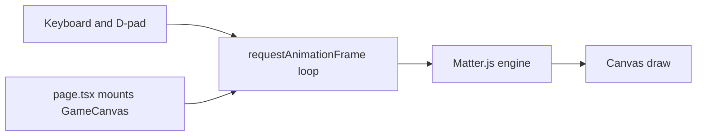

# Next.js Top-Down Physics Car

## Goal
A minimal Next.js app with **no landing page**: opening `/` shows a full-screen top-down 2D plane and a black car block you can drive with keyboard and mobile on-screen controls.

## Stack (concrete choices)
- **Next.js** (App Router) + TypeScript + Tailwind
- **Matter.js** for 2D rigid-body physics (force, torque, friction, inertia)
- **HTML Canvas** rendered client-side (game loop outside React render)
- **Controls**: WASD / arrow keys + on-screen D-pad (touch)

## UX
- Full viewport, no nav/hero/marketing
- Light gray/off-white ground plane so the black car reads clearly
- Soft world bounds (invisible walls) so the car stays on screen
- Mobile: fixed bottom-left D-pad (↑ ↓ ← →); buttons use `touch-action: none` to avoid scroll/zoom

## Architecture

### Files to create
- [`package.json`](package.json) — `next`, `react`, `matter-js`, Tailwind
- [`app/layout.tsx`](app/layout.tsx) — minimal root layout, no chrome
- [`app/page.tsx`](app/page.tsx) — client mount of the game only
- [`app/globals.css`](app/globals.css) — full-height, overflow hidden, no default page padding
- [`components/GameCanvas.tsx`](components/GameCanvas.tsx) — canvas + D-pad overlay; init/teardown Matter world in `useEffect`
- [`lib/game/createWorld.ts`](lib/game/createWorld.ts) — Matter engine, ground bounds, black car rectangle body
- [`lib/game/controls.ts`](lib/game/controls.ts) — shared input state (`forward`, `back`, `left`, `right`) from keyboard + touch
- [`lib/game/carPhysics.ts`](lib/game/carPhysics.ts) — each tick: apply thrust along car facing, steering torque, linear/angular damping for car-like drag
- [`lib/game/render.ts`](lib/game/render.ts) — clear canvas, draw plane, draw car as filled black rect rotated to body angle

## Car physics behavior
Top-down “real” feel without sprites:
- Throttle applies force in the car’s forward direction (`angle`)
- Reverse applies opposite force (weaker)
- Left/right apply angular velocity / torque while moving
- Strong linear damping + moderate friction so it coasts then stops (not ice-rink floaty)
- Body: Matter rectangle, render as solid black block

## Controls mapping
| Input | Action |
|-------|--------|
| W / ↑ / D-pad up | Accelerate |
| S / ↓ / D-pad down | Brake / reverse |
| A / ← / D-pad left | Steer left |
| D / → / D-pad right | Steer right |

## Implementation notes
- Mark game UI as `"use client"`; keep physics off the server
- Resize canvas to `window.innerWidth/Height` on mount and `resize`
- Cleanup: stop engine, remove listeners, cancel `requestAnimationFrame` on unmount
- D-pad: `pointerdown` / `pointerup` / `pointerleave` set booleans (works for mouse + touch)
- No auth, routes, or extra pages

## Out of scope (for this pass)
- Sprites, maps, collisions with other cars, multiplayer, sound, score UI
