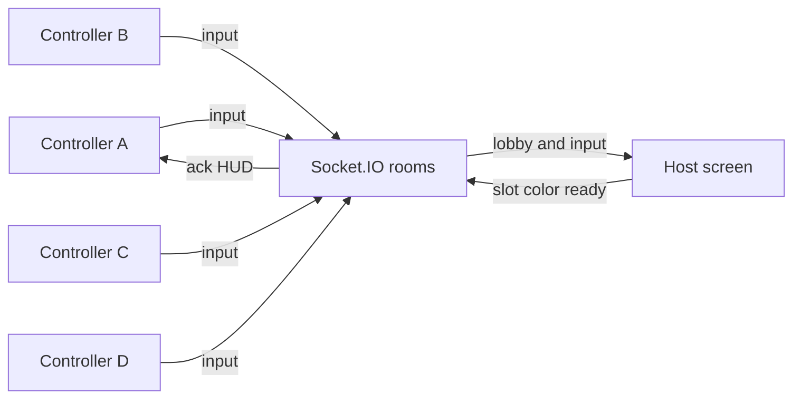

# Screen + Controller Multiplayer

## What you already have
Solo top-down Matter.js car on `/` via [`components/GameCanvas.tsx`](components/GameCanvas.tsx). Input is a mutable `{ forward, back, left, right }` object in [`lib/game/controls.ts`](lib/game/controls.ts); the RAF loop applies it in [`lib/game/carPhysics.ts`](lib/game/carPhysics.ts). There is no networking yet. `matter-js` is imported but missing from [`package.json`](package.json) — add it (and types) while adding realtime deps.

## Design choices (confirmed)
- **4 phones max** per room
- **Screen is display-only** (no keyboard car while hosting)
- **Solo mode stays** on a simple home menu
- **Screen client is physics authority**: phones only send button state; the host simulates and draws. The Node server is a room registry + relay, not a physics sim.



## Why Socket.IO (custom Next server)
Phones and the TV must share one code even if they are not the same browser. A small Node HTTP server wraps Next and attaches Socket.IO so rooms live in memory on that process.

- Add `socket.io`, `socket.io-client`, `matter-js`, `@types/matter-js`
- Add [`server.ts`](server.ts) (run with `tsx`): create Next handler, `http.createServer`, `new Server(io)`
- Change scripts: `"dev": "tsx server.ts"`, `"start": "NODE_ENV=production tsx server.ts"` (or compile). Stock `next dev` cannot host these rooms.
- **Party caveat:** phones must open the host machine’s LAN URL (e.g. `http://192.168.x.x:3000/join`), not `localhost`. The host overlay will show the join URL + code.

This will **not** work on Vercel serverless (no sticky in-memory sockets). It will work on a PC/LAN or any always-on Node host.

## Room protocol
Short **4-character codes** (`A-Z` + `2-9`, skip ambiguous `O/0/I/1`). Shared types in [`lib/net/protocol.ts`](lib/net/protocol.ts).

| Role | Events |
|------|--------|
| Screen | `host:create` → `{ code }` |
| Phone | `controller:join` `{ code }` → `{ playerId, slot, color }` or error |
| Phone | `controller:input` `{ forward, back, left, right }` (send on press/release only, not every frame) |
| Server → screen | `room:state` `{ players: [{ id, slot, color, connected }] }` |
| Screen | `host:start` — hide big code, spawn cars, begin sim |
| Server → phones | `room:started`, `room:ended`, `you:assign`, `room:error` |
| Disconnect | drop that slot; freeze/remove that car; others keep playing |

Server rules in [`lib/net/rooms.ts`](lib/net/rooms.ts): one screen socket per room, max 4 controllers, reject join after start (or allow late join into an empty slot — **late join allowed if a slot is free**). Empty room (no screen) is deleted.

## UI flow
1. [`app/page.tsx`](app/page.tsx) becomes a minimal menu: **Solo**, **Host screen**, **Join as controller**.
2. [`app/host/page.tsx`](app/host/page.tsx): full-viewport canvas + overlay with large code, player chips (color + “connected”), **Start** enabled when ≥1 controller. After start, a small persistent HUD: code + player count (so late joiners still can).
3. [`app/join/page.tsx`](app/join/page.tsx): code entry (4 boxes), then full-screen D-pad, player color banner, connection status. Extract the existing pad into [`components/ControllerPad.tsx`](components/ControllerPad.tsx) and reuse it from solo + join.
4. Solo keeps current [`GameCanvas`](components/GameCanvas.tsx) behavior (keyboard + on-screen pad on the same device).

Host GameCanvas variant (e.g. `HostGameCanvas`) will:
- Create the socket as `role: screen`
- Keep `Map<playerId, InputState>`
- On `controller:input`, `Object.assign` that player’s input
- On start, spawn up to 4 cars (only for joined slots)

## Game changes (multi-car)
[`lib/game/createWorld.ts`](lib/game/createWorld.ts): `createWorld(width, height, cars: { id, color, x, y }[])` — multiple Matter rectangles, still zero gravity, same walls.

Spawn in a small diamond around center so they do not overlap.

[`lib/game/render.ts`](lib/game/render.ts): draw each car in its slot color (e.g. `#1d4ed8`, `#dc2626`, `#16a34a`, `#d97706`) plus the dark nose mark.

Tick in the host canvas:

```ts
for (const car of world.cars) {
  updateCarPhysics(car.body, inputs.get(car.id) ?? idle);
}
Matter.Engine.update(world.engine, dt);
renderFrame(ctx, world.width, world.height, world.cars);
```

Car-car collisions come free from Matter once multiple bodies exist.

## Client hook
[`lib/net/useGameSocket.ts`](lib/net/useGameSocket.ts): connect to `window.location.origin`, expose `createRoom`, `joinRoom`, `sendInput`, `startGame`, `players`, `status`. Singleton socket per page; disconnect on unmount so leaving `/host` frees the room.

## Verification (no real second phone required, but preferred)
- Solo still drives with keyboard + pad
- Host shows a code; join with another browser tab as controller; Start; pad moves the matching colored car
- Second/third/fourth joiners get distinct colors
- Disconnect a controller: that car stops receiving input
- Wrong/full/expired code shows an error on `/join`
- If a browser is available: host in one window, controller in a second window (and a phone on LAN if possible)

## Out of scope
Sprites, scoring, tracks, voice, reconnection to a mid-race identity beyond slot reuse, Vercel deploy, WebRTC P2P.
